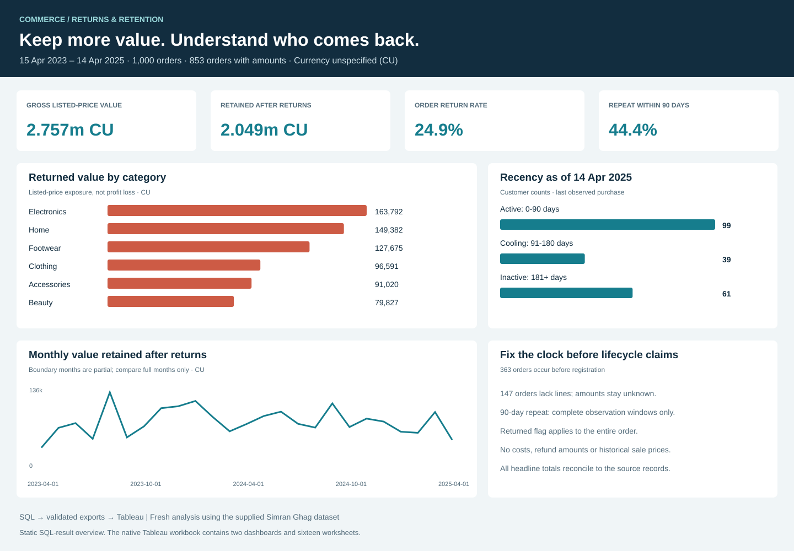

# Commerce: Returns & Customer Retention

**Project by Tejyashwar**

A complete SQL-to-Tableau case study investigating returned sales value, repeat purchasing and customer recency. Built as a fresh analysis from the supplied dataset, with a reproducible pipeline and explicit data-quality handling.



**[Download the Tableau workbook](tableau/Commerce.twbx)** · **[Read the findings](docs/REPORT.md)** · **[View validation results](docs/validation.json)**

## Business questions

1. How much recorded listed-price value remains after excluding returned orders?
2. Which categories create the largest returned-value exposure, and which regions have high order return rates?
3. What fraction of customers purchase again within 90 days, with equal follow-up time?
4. Which previously valuable customers merit a win-back pilot?
5. Which source defects could change management's interpretation?

## Results

| Metric | Result |
|---|---:|
| Orders / order lines | 1,000 / 2,000 |
| Purchasing customers | 199 |
| Recorded gross listed-price value | 2,757,346.10 CU |
| Recorded retained value | 2,049,059.34 CU |
| Recorded returned value | 708,286.76 CU |
| Order return rate (all 1,000 orders) | 24.9% |
| Repeat within 90 days | 44.4% (87 / 196 eligible customers) |
| Win-back review list | 32 customers |

**Coverage matters:** 147 orders have no lines, so their amounts remain unknown. Monetary results cover 853 orders with recorded lines. Also, 363 orders predate registration. Counts retain all orders; cohorts use first observed purchase. Values use supplied list prices in unspecified currency units (CU), not actual invoice revenue or profit. Coverage is 15 April 2023–14 April 2025; both boundary months are partial.

## Run the whole project

Requirements: Python 3.10+ with SQLite 3.35+ and Tableau Desktop to view the workbook. No third-party Python packages, database server, credentials or internet access are required for the build.

```sh
python3 scripts/build.py
python3 -m unittest discover -s tests -v
```

The build executes the SQL, exports CSVs, validates the results, creates a portable Tableau package and generates an HTML report. Open `tableau/Commerce.twbx` in Tableau Desktop. The unpackaged `Commerce.twb` and its `Data/` folder are also included for editing. Open `docs/report.html` for the standalone report.

**SQL dialect:** SQLite. Python only orchestrates SQL execution, checks, exports and artifact generation; all analytical transformations and business metrics live in SQL. Do not run the date functions unchanged in MySQL. The original MySQL-style source schema/INSERT records are loadable by SQLite and are kept separately from the new analysis.

To inspect the finished database directly:

```sh
sqlite3 data/commerce.sqlite
```

```sql
SELECT * FROM order_facts LIMIT 5;
SELECT * FROM customer_activity WHERE recency_days > 90;
```

## Tableau dashboards

**01 Sales and Returns:** four headline KPIs, monthly retained value, returned value by category, order return rate by region, and value return rate by category.

**02 Customer Retention:** purchasing customers, eligible repeat rate, eligible-customer count, win-back review count, customer recency distribution, historical retained value by recency, first-order quarter repeat rate, and monthly order volume.

Sixteen editable worksheets use SQL-generated summary sources. Hover/select marks to inspect them. Sources have different grains: there is no shared global filter, and dashboard totals are full-period totals. Category order counts are not additive because an order can contain multiple categories. Recent cohorts without a complete observation window have a blank 90-day rate, not zero.

See [Tableau usage and refresh](docs/TABLEAU.md), [metric definitions](docs/METRICS.md), and [QA evidence](docs/QA.md).

## Project structure

```text
data/raw/              Attributed source schema + records and provenance hashes
data/commerce.sqlite   Rebuilt database, normalized source tables and analytical views
data/exports/          Ten SQL-generated datasets, including the customer review list
sql/01_models.sql      Line, order and customer-grain views
sql/analysis/          Ten independent business queries
scripts/               Rebuild, validation, report and Tableau authoring
tableau/               Packaged/editable workbooks and embedded CSVs
docs/                  Findings, dashboard preview, methodology and validation evidence
tests/                 Date-boundary, missing-value, money and package tests
```

## Source and authorship

Dataset schema and records were supplied in [Simran Subhash Ghag's e-commerce capstone](https://github.com/Simranghag22/ecommerce-analysis-sql-capstone), commit `04f0299ce7fdff88f4108a83034510f626f9b261`. Only table definitions and INSERT records were extracted; the original SQL analyses, Tableau dashboard, report and presentation are not included here. The new analysis, pipeline, report and dashboard were developed for Tejyashwar with Codex assistance. Dataset provenance is retained in `data/raw/provenance.json`.

No dataset license was supplied in the source snapshot. This repository does not grant additional rights over third-party material.
